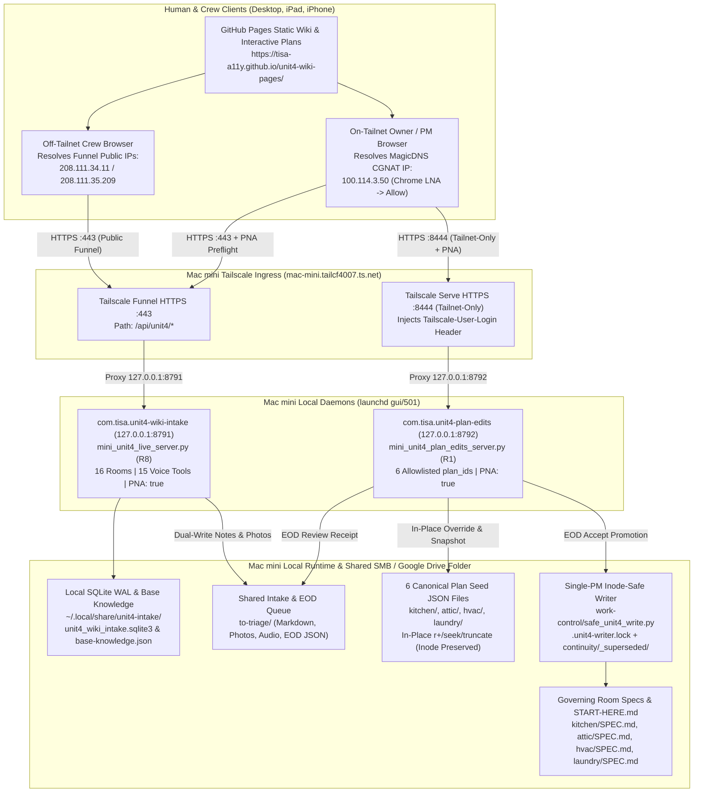

# Unit 4 Backend Architecture, Networking & Operational Runbook (Canonical)

- **Backend, Ingress & Storage Owner:** `@ag-unit-4-backend` (`antigravity:conv:e32a9ccf`)
- **Frontend & Style Counterpart:** `work-control/UNIT4-FRONTEND-STYLE-GUIDE.md` (`@ag-unit-4-wiki-frontend`, `antigravity:conv:0ed9bd5d`)
- **Authority & Mandate:** Tisa Vo (`2026-11-20 PT`):
  - *"make sure the backend work is documented as well as any frontend design or style guides. the documentation has to exist in all the places needed including gdrive and not just github"*
- **Canonical Locations:**
  1. **SMB / Google Drive Shared Source:** `/Volumes/tisavo/Agent Shared - Mini Hosted/1231 11th Avenue Unit 4/work-control/UNIT4-BACKEND-ARCHITECTURE-AND-RUNBOOK.md` (and native Google Doc mirror in Drive `work-control` folder `1RKGCkcRPvIJG55AUF2vUQ084pHRsk4MV`).
  2. **Service-Specific Companion Runbooks:**
     - `work-control/unit4-gemini-live-mini-r5/README.md` (Voice Agent R8, Knowledge Base, Field Notes, Photo/Camera Upload, and Product Lookup on `:8791`).
     - `work-control/unit4-plan-edits-r1/README.md` (Tailscale-Only Interactive Plan Edits & End-of-Day Review on `:8444` -> `127.0.0.1:8792`).
  3. **Indexed Knowledge Base:** Automatically compiled into `work-control/unit4-backend-knowledge-latest.json` (and `/Users/tisavo/.local/share/unit4-intake/base-knowledge.json` on Mac mini) by `work-control/unit4-gemini-live-mini-r5/build_r8_knowledge.py`.
- **Privacy & Security Contract:** Strictly zero currency symbols or pricing amounts, zero raw API keys or tokens, zero private owner or tenant identifiers, and zero unverified external URLs.

---

## 1. End-to-End System Architecture & Two-Tier Ingress Split

The 1231 11th Avenue Unit 4 renovation platform separates public static crew delivery (GitHub Pages CDN) from two isolated Python HTTP services hosted on the always-on Mac mini (`mac-mini.tailcf4007.ts.net`):

1. **Tier 1 — Public Tailscale Funnel Ingress (`:443 /api/unit4/*` -> `127.0.0.1:8791`):**
   - Managed by LaunchAgent `com.tisa.unit4-wiki-intake` (`work-control/unit4-gemini-live-mini-r5/mini_unit4_live_server.py`).
   - Serves field-note and voice-memo intake (`to-triage/`), multi-photo and live camera uploads, Gemini Live 3.1 Flash bidirectional voice sessions (15 tools across 16 allowlisted rooms), scrubbed knowledge search (`GET /api/unit4/knowledge`), and zero-metal tile/material product lookups (`POST /api/unit4/product-lookup`).
2. **Tier 2 — Tailnet-Only Plan-Edit & End-of-Day Review Ingress (`:8444 /api/unit4/plans/*` -> `127.0.0.1:8792`):**
   - Managed by LaunchAgent `com.tisa.unit4-plan-edits` (`work-control/unit4-plan-edits-r1/mini_unit4_plan_edits_server.py`).
   - Exposed exclusively on the private Tailscale tailnet (`https://mac-mini.tailcf4007.ts.net:8444`), never on Tailscale Funnel.
   - Rejects any request carrying `Tailscale-Funnel-Request` with HTTP `403`, verifies `Tailscale-User-Login` identity on mutation endpoints, enforces optimistic concurrency (`base_rev`), validates `measure_boundary` and private-data regex firewall rules, writes plan seed JSON files in place (`r+`/`seek(0)`/`write`/`truncate`/`fsync`) so inodes and Google Drive File IDs never change, and promotes End-of-Day (`EOD`) accepted overrides into governing room `SPEC.md` files via `work-control/safe_unit4_write.py`.



---

## 2. Service 1 — Voice Agent R8, Knowledge Base, Field Notes, Photos & Product Lookup (`:8791`)

- **LaunchAgent Label:** `com.tisa.unit4-wiki-intake`
- **Plist Path:** `/Users/tisavo/Library/LaunchAgents/com.tisa.unit4-wiki-intake.plist`
- **Deployed Script (Mac mini):** `/Users/tisavo/.local/share/unit4-intake/mini_unit4_live_server.py`
- **Canonical SMB Source:** `work-control/unit4-gemini-live-mini-r5/mini_unit4_live_server.py`
- **Knowledge Compiler:** `work-control/unit4-gemini-live-mini-r5/build_r8_knowledge.py`
- **Unit Test Suite:** `work-control/unit4-gemini-live-mini-r5/test_voice_r8_server.py` (`8/8` tests `OK`)
- **Public Funnel Base URL:** `https://mac-mini.tailcf4007.ts.net/api/unit4`

### 2.1 HTTP Endpoints & Wire Schemas on `:8791`

| Method & Path | Auth Header | Purpose | Request / Query Schema | Response Contract |
|---|---|---|---|---|
| `OPTIONS /api/unit4/*` | None | CORS & Private Network Access preflight | `Origin`, `Access-Control-Request-Method`, `Access-Control-Request-Private-Network: true` | HTTP `204 No Content` with `Access-Control-Allow-Origin`, `Access-Control-Allow-Methods`, `Access-Control-Allow-Headers`, and `Access-Control-Allow-Private-Network: true` |
| `GET /api/unit4/healthz` | None (or `X-Unit4-Key`) | Service health, R9 capabilities & counts | None | HTTP `200 OK`: `{"ok": true, "version": "r9-voice-18tools-persistent-live-ai", "galleryEndpoint": "/api/unit4/gallery", "galleryUploadEndpoint": "/api/unit4/gallery/upload", "allowedGalleries": ["renders", "references"], "allowedRooms": [...], "voiceTools": [...18 tools...]}` |
| `POST /api/unit4/voice-token` | None | Mint single-use Gemini Live ephemeral token (`<450ms` direct cached-model fast path) | JSON body: `{"uiLanguage": "en\|es"}` | HTTP `200 OK`: `{"ok": true, "token": "auth_tokens/...", "model": "models/gemini-3.8-live", "uiLanguage": "en\|es", "setup": {"realtimeInputConfig": {"automaticActivityDetection": {"startOfSpeechSensitivity": "START_SENSITIVITY_HIGH", "endOfSpeechSensitivity": "END_SENSITIVITY_HIGH", "prefixPaddingMs": 100, "silenceDurationMs": 450}}, "systemInstruction": {...}, "tools": [...18 tools...]}, "wsUrl": "wss://..."}` |
| `GET /api/unit4/knowledge` | `X-Unit4-Key` | Search scrubbed project knowledge & interactive plan directory | Query params: `q` (search string), `room` (optional room slug), `scope` (`all`, `specs`, `checklists`, `interactive_plans`, `architecture`, `triage`), `format` (`all`, `md`, `json`, `html`, `pdf`), `limit` (1–50) | HTTP `200 OK`: `{"ok": true, "schema": "unit4-knowledge-query-v1", "count": 2, "totalMatched": 2, "results": [...], "interactivePlans": {...}, "allowedRooms": [...]}` (strictly `0` currency symbols, `0` secrets) |
| `POST /api/unit4/wiki-intake/voice-memo` (also `/api/unit4/intake`) | `X-Unit4-Key` | Field notes, voice memos, multi-photo/camera capture & structured `proposed_edit` intake | JSON body: `{"room": "<slug>", "author": "<name>", "note": "<text>", "transcript": "<text>", "photo": {"name": "...", "type": "image/jpeg", "size": 12345, "data": "data:image/...;base64,..."} or "<data-url>", "photos": [...], "proposed_edit": {"target_type": "interactive_plan|room_spec|checklist", "plan_id": "...", "element_id": "...", "proposed_value": "...", "measure_boundary": "..."}}` | HTTP `200 OK`: `{"ok": true, "submission_id": "u4-...", "room": "...", "triage_markdown_path": "...", "saved_photos": [...], "interactive_plan_hint": {...}}` |
| `POST /api/unit4/product-lookup` | `X-Unit4-Key` | Tile & material lookup by name, HTTPS URL, or live camera photo with matching trim & zero-metal validation | JSON body: `{"mode": "query_search|url_search|camera_vision", "query": "...", "url": "https://...", "image_data_url": "data:image/...", "room": "kitchen-oven-range", "check_matching_trim_parts": true, "include_retail_estimate": false}` | HTTP `200 OK`: `{"ok": true, "mode": "...", "products": [{"name": "...", "nominal_size_in": "...", "actual_size_in": "...", "thickness_in": "...", "material": "...", "edge_profile_options": [...], "matching_trim_parts": [...], "recommended_trim_options": [...], "retail_estimate": null}], "zero_metal_trim_guidance": "..."}` |
| `GET /api/unit4/gallery` | None | Fetch per-room dual galleries (`renders` = Rendered Images & Mockups, `references` = Reference Photos) | Query params: `room=<room_key>` (one of 16 `ALLOWED_ROOMS` or `all`), optional `gallery=renders\|references` | HTTP `200 OK`: `{"ok": true, "schema": "unit4-room-gallery-v2-dual", "room": "...", "galleryFilter": "all", "allowedGalleries": ["renders", "references"], "rendersCount": 1, "referencesCount": 1, "count": 2, "renders": [...], "references": [...], "items": [...], "photos": [...], "conceptRenders": [...]}` (`400` on invalid room or gallery key) |
| `POST /api/unit4/gallery/upload` | None | Upload an image to a room's `renders` or `references` gallery on Drive-synced SMB storage without touching locked `.md` specs | Supports `application/json` (`{"room": "<room_key>", "gallery": "renders\|references", "caption": "...", "author": "...", "filename": "...", "image_base64": "data:image/...;base64,..."}`) or `multipart/form-data` (`room`, `gallery`, `caption`, `author`, file `file`/`image`/`photo`) | Validates `room` in `ALLOWED_ROOMS`, `gallery` in `{"renders", "references"}`, magic-byte MIME (`image/jpeg`, `image/png`, `image/webp`, `image/gif`, `image/heic`), max `15 MB`, scrubs currency/private strings, writes `<Unit 4 Root>/room-gallery/<room>/<gallery>/<filename>` + atomic in-place `gallery-manifest.json`, returns HTTP `200 OK` with `item`, `renders`, `references` |
| `GET /api/unit4/gallery/file/<room_key>/<gallery>/<filename>` (and `/file/<room_key>/<filename>`) | None | Serve binary gallery image with traversal guard & PNA/CORP headers | URL path segments `<room_key>`, `<gallery>` (`renders\|references`), `<filename>` (`^[A-Za-z0-9][A-Za-z0-9._-]{0,120}`) | HTTP `200 OK` binary image with `Content-Type`, `Cache-Control: public, max-age=3600`, `X-Content-Type-Options: nosniff`, `Cross-Origin-Resource-Policy: cross-origin`, `Access-Control-Allow-Origin`, `Access-Control-Allow-Private-Network: true` (`400` on traversal/invalid key, `404` if missing) |
| `POST /api/unit4/gemini-live/session` & `/api/unit4/voice-turn` | `X-Unit4-Key` | Bidirectional Gemini Live 3.8 Live voice session & tool execution | Audio PCM/WebM chunks or text turn + active room context | Live audio/transcript stream + executed tool results across 18 declared R9 voice tools |

### 2.2 All 16 Allowlisted Rooms (`ALLOWED_ROOMS`)

`home`, `roadmap`, `decisions`, `kitchen`, `kitchen-oven-range`, `kitchen-sink-north`, `bathroom`, `electrical`, `laundry`, `bedroom`, `living-dining`, `hallway`, `paint-floors`, `hvac`, `attic-access`, `agents`.

### 2.3 All 18 Voice Agent R9 Tools (`VOICE_TOOLS_DECLARATION`)

1. `query_todoist_cards` — Search and filter Unit 4 Todoist cards and synchronized wiki checklist/spec items by room, keyword, card ID, or status (`all`, `open`, `done`).
2. `navigate_room` — Open an approved Unit 4 room or overview page and return its governing spec, checklist, and document list.
3. `focus_section` — Scroll to and focus a section heading inside the current room page.
4. `open_document` — Open an approved crew PDF drawing or plan in the in-page viewer (optionally at a specific page).
5. `go_to_document_page` — Scroll the currently open in-page PDF document to a specific 1-based page number.
6. `read_active_document` — Read the full governing spec, checklist, or extracted PDF page text currently open on screen.
7. `set_language` — Switch the wiki UI chrome between English (`en`) and Mexican Spanish (`es`) without clearing drafts.
8. `fill_draft_note` — Populate a visible draft note in the room Field Reports form or Quick-Post panel verbatim in the speaker's language.
9. `submit_voice_memo` — Route a confirmed note verbatim into Google Drive `to-triage/` after mandatory 2-step readback confirmation.
10. `show_room_renders` — Display clickable Unit 4 concept renders / visual mockups in chat and on the room page.
11. `get_pm_standup_brief` — Fetch the live Unit 4 Project Manager standup brief from Mac mini (`STATUS-NOW.md` excerpt, Pass 1 new `to-triage/` items, Pass 2 `_deferred/` items, and room checklist counts).
12. `load_pm_skill` — Load a Unit 4 Project Manager or trade specialist `SKILL.md` playbook by slug from the synced Unit 4 workspace.
13. `apply_pm_action` — Stage a new unapproved task strictly in Todoist `New Tasks (need triage)` (`6hvgpr6jg95wPchf`) with a `to-triage/` audit receipt (`X-Unit4-PM-Pin` required).
14. `query_wiki_and_backend_knowledge` — Search all compiled records (`START-HERE.md`, room `SPEC.md`s, `CHECKLIST.md`s, 6 JSON plan models, PDFs, frontend style guide, and backend runbooks).
15. `propose_wiki_or_plan_edit` — Capture a structured edit proposal (`room`, `edit_kind`, `target_item`, `new_value`, `old_value`, `measure_boundary`, `author`, `verbatim_request`, `spoken_confirmation`) into `to-triage/` with an automatic `:8444` interactive-plan routing hint.
16. `show_plan_view` — Open or switch to one of the 6 interactive plans (`kitchen-floor-plan`, `kitchen-west-ks4`, `kitchen-electrical`, `attic-hatch`, `hvac-layout`, `murphy-door`) and/or switch its active wall elevation (`south`, `east`, `west`, `north`, `plan`, `all`), `step` number, or `zoom` level.
17. `update_plan_state` — Live-edit or adjust a dimension, slider, option toggle, or movable node (`action`, `target`, `value`) on the currently active interactive plan in real time.
18. `capture_screen_snapshot` — Take a live visual screenshot / snapshot (`target`, `label`) of the currently visible interactive plan, SVG drawing, PDF page, or room view so it appears in the conversation and the Live AI can inspect what is on screen.

### 2.4 Product Lookup SSRF Protection & Zero-Metal Edge Rule

- **SSRF Guard (`url_search` mode):**
  - Only `https://` URLs with a valid public hostname are permitted (`http://`, `file://`, `ftp://`, `data://`, and credentials in URLs are rejected with HTTP `400`).
  - Resolves target hostnames via `socket.getaddrinfo` before any outbound fetch and rejects any IP address that is loopback (`127.0.0.0/8`, `::1`), private (`10.0.0.0/8`, `172.16.0.0/12`, `192.168.0.0/16`), link-local (`169.254.0.0/16`, `fe80::/10`), multicast, unspecified, or Tailscale CGNAT (`100.64.0.0/10`), as well as `.local`, `.lan`, `.internal`, and `.ts.net` suffixes.
- **Matching Trim Parts & Zero-Metal Enforcement:**
  - `check_matching_trim_parts` defaults to `true`: every product result returns `matching_trim_parts[]` (surface bullnose, pencil liner, quarter-round molding, cove base) and `recommended_trim_options[]`.
  - Any metallic or aluminum edge profile strings are scrubbed from `edge_profile_options`, `recommended_trim_options`, and product `notes`.
  - `zero_metal_trim_guidance` enforces Unit 4's locked standard: ceramic bullnose, glazed pencil trim, quarter-round ceramic molding, or color-matched 100% silicone at inside 90-degree corners, and **never** 45-degree mitered tile edges on flat wall returns (which expose a fragile 90-degree lip where tile meets flat painted drywall).
- **Default Zero-Currency Contract:**
  - `include_retail_estimate` defaults to `false`. When `false` (mandatory for all public GitHub Pages crew pages), `retail_estimate` is `null` and the serialized JSON response contains zero currency symbols.

---

## 3. Service 2 — Tailscale-Only Interactive Plan Edits & End-of-Day Review (`:8444` -> `127.0.0.1:8792`)

- **LaunchAgent Label:** `com.tisa.unit4-plan-edits`
- **Plist Path:** `/Users/tisavo/Library/LaunchAgents/com.tisa.unit4-plan-edits.plist`
- **Deployed Script (Mac mini):** `/Users/tisavo/.local/share/unit4-plan-edits/mini_unit4_plan_edits_server.py`
- **Canonical SMB Source:** `work-control/unit4-plan-edits-r1/mini_unit4_plan_edits_server.py`
- **Unit Test Suite:** `work-control/unit4-plan-edits-r1/test_mini_unit4_plan_edits_server.py` (`5/5` tests `OK`)
- **Tailnet-Only HTTPS Base URL:** `https://mac-mini.tailcf4007.ts.net:8444/api/unit4/plans`

### 3.1 All 6 Allowlisted Interactive `plan_id`s

| `plan_id` | Canonical Seed JSON Path (SMB & Drive) | Governing Spec (`EOD accept` Target) | `room_id` | `element_label` | Live GitHub Pages Route |
|---|---|---|---|---|---|
| `kitchen-west-ks4` | `kitchen/kitchen-west-ks4-plan-data.json` | `kitchen/SPEC.md` | `kitchen` | `K-S4` | `./plans/kitchen-west-ks4/` |
| `kitchen-floor-plan` | `kitchen/kitchen-cabinet-schedule.json` | `kitchen/SPEC.md` | `kitchen` | `KITCHEN-FLOOR-PLAN` | `./plans/kitchen-floor-plan/` |
| `kitchen-electrical` | `kitchen/kitchen-electrical-plan-data.json` | `kitchen/SPEC.md` | `kitchen` | `KITCHEN-ELECTRICAL-01` | `./plans/kitchen-electrical/` |
| `attic-hatch` | `attic/attic-hatch-plan-data.json` | `attic/SPEC.md` | `attic` | `ATTIC-HATCH-01` | `./plans/attic-hatch/` |
| `hvac-layout` | `hvac/hvac-layout-plan-data.json` | `hvac/SPEC.md` | `hvac` | `HVAC-ATTIC-LAYOUT-01` | `./plans/hvac-layout/` |
| `murphy-door` | `laundry/murphy-door-plan-data.json` | `laundry/SPEC.md` | `laundry` | `MURPHY-DOOR-B` | `./plans/murphy-door/` |

### 3.2 HTTP Endpoints & Optimistic Concurrency on `:8444` (`:8792`)

| Method & Path | Tailnet Guard | Purpose | Request Schema | Response & Storage Contract |
|---|---|---|---|---|
| `OPTIONS /api/unit4/plans/*` | Rejects Funnel (`403`) | CORS & PNA preflight | `Origin: https://tisa-a11y.github.io`, `Access-Control-Request-Private-Network: true` | HTTP `204 No Content` with `Access-Control-Allow-Private-Network: true` |
| `GET /api/unit4/plans/health` | Rejects Funnel (`403`) | Service-level health across all 6 plans | None | HTTP `200 OK`: `{"ok": true, "service": "unit4-plan-edits-r1", "allowlisted_plans": [...]}` |
| `GET /api/unit4/plans/<plan_id>/health` | Rejects Funnel (`403`) | Per-plan health, seed readiness & revision check | None | HTTP `200 OK`: `{"ok": true, "plan_id": "...", "seed_ready": true, "base_rev": "...", "pending_eod_count": 0, "governing_spec": "..."}` |
| `GET /api/unit4/plans/<plan_id>` | Rejects Funnel (`403`) | Fetch live seed JSON & pending EOD queue | None | HTTP `200 OK`: `{"ok": true, "plan_id": "...", "base_rev": "...", "plan_data": {...}, "pending_eod": [...]}` |
| `POST /api/unit4/plans/<plan_id>/override` | Requires `Tailscale-User-Login` (Rejects Funnel `403`) | Apply an immediate in-place field override & queue for EOD review | `{"base_rev": "<current-rev>", "author": "...", "reason": "...", "measure_boundary": "wall_to_wall|to_outer_casing|to_casing_edge|clear_between_casings|rough_opening|aff|subfloor", "patch": {...}}` | Verifies `base_rev` (returns HTTP `409 Conflict` on mismatch), validates schema & private-data regex firewall (returns HTTP `400` on violation or attempt to mutate `flagged_clashes`), snapshots exact pre-edit bytes, writes JSON in place (`r+`/`seek(0)`/`write`/`truncate`/`fsync`), and logs an EOD review record to `to-triage/`. |
| `POST /api/unit4/plans/<plan_id>/eod` | Requires `Tailscale-User-Login` (Rejects Funnel `403`) | End-of-Day `accept` (promote to `SPEC.md`) or `reject` (atomic byte revert) | `{"action": "accept|reject", "base_rev": "<current-rev>", "override_id": "optional-id", "reviewer": "...", "note": "..."}` | **`reject`**: atomically restores exact pre-edit byte snapshot in place (`st_ino` preserved). **`accept`**: invokes `work-control/safe_unit4_write.py` to record accepted dimension/option in the governing room `SPEC.md` (`st_ino` and Google Drive File ID preserved). |

---

## 4. Networking, Tailscale DNS Split & Chrome 142+ Local Network Access (LNA / PNA)

### 4.1 Why Off-Tailnet and On-Tailnet Devices Resolve `mac-mini.tailcf4007.ts.net` Differently

| Client Network State | DNS Resolver Used | Resolved IP for `mac-mini.tailcf4007.ts.net` | Reachable Ports | Browser Network Classification (From `https://tisa-a11y.github.io`) |
|---|---|---|---|---|
| **Off-Tailnet** (e.g., crew phone or tablet on cellular / external Wi-Fi) | Public DNS | `208.111.34.11` / `208.111.35.209` (Tailscale Funnel public ingress relays) | `:443 /api/unit4/*` (`:8791` Funnel) | **Public -> Public HTTPS** (Zero Chrome LNA prompt; standard CORS) |
| **On-Tailnet** (e.g., Tisa's or John's MacBook / iPhone connected to Tailscale) | Tailscale MagicDNS (`100.100.100.100`) | `100.114.3.50` (Tailscale CGNAT `100.64.0.0/10`) | `:443 /api/unit4/*` (`:8791`) **AND** `:8444 /api/unit4/plans/*` (`:8792` Tailnet-Only) | **Public (`github.io`) -> Private/CGNAT (`100.114.3.50`)** — Triggers Chromium Private Network Access (`PNA`) & Chrome 142+ Local Network Access (`LNA`) checks |

### 4.2 Server-Side PNA Headers & Client-Side Chrome 142+ Site Permission

1. **Mandatory Server Header (`Access-Control-Allow-Private-Network: true`):**
   - Both `mini_unit4_live_server.py` (`:8791`) and `mini_unit4_plan_edits_server.py` (`:8792` / `:8444`) emit `Access-Control-Allow-Private-Network: true` on **every** `OPTIONS` preflight and HTTP response when `Origin` matches the allowlist (`https://tisa-a11y.github.io` or `http(s)://localhost:*` / `127.0.0.1:*`).
   - Enforced by automated unit tests in `test_voice_r8_server.py` and `test_mini_unit4_plan_edits_server.py`.
2. **One-Time Chrome 142+ User Action on Tailnet Devices:**
   - When browsing `https://tisa-a11y.github.io/unit4-wiki-pages/` on a device actively connected to Tailscale, Chrome 142+ gates fetches to `100.114.3.50` behind a browser site permission (`Local network access`).
   - If the permission was dismissed or blocked in Chrome:
     1. Click the **tune / lock icon** on the left side of the Chrome address bar on `https://tisa-a11y.github.io/unit4-wiki-pages/`.
     2. Set **`Local network access`** to **`Allow`**.
     3. Reload the page (`Cmd+R`). Both `:443` (`/api/unit4/*`) and `:8444` (`/api/unit4/plans/*`) will connect immediately (`200 OK`).

---

## 5. Storage Integrity, Inode Preservation, SQLite WAL & LaunchAgent Operations

### 5.1 File-Overwrite & Inode Preservation Guard (`AGENTS.md` Mandatory Rule)

1. **One Mac Write Path:**
   - All writes to the Unit 4 project folder MUST go through the canonical SMB / local Mini path:
     - MacBook Pro: `/Volumes/tisavo/Agent Shared - Mini Hosted/1231 11th Avenue Unit 4` (or `~/Tisa AI/Agent Shared - Mini Hosted/1231 11th Avenue Unit 4`)
     - Mac mini local disk: `/Users/tisavo/Tisa AI/Agent Shared - Mini Hosted/1231 11th Avenue Unit 4`
   - Never write through `~/Tisa AI/Agent Shared - Mini Hosted (Drive)` / `GoogleDrive-*` (blocked by `work-control/safe_unit4_write.py` to prevent dual-sync inode splits and `(1)` conflict copies).
2. **In-Place File Mutations (`st_ino` & Google Drive File ID Preserved):**
   - `work-control/safe_unit4_write.py` acquires `work-control/.unit4-writer.lock`, verifies `--expected-sha256`, archives the prior snapshot to `continuity/_superseded/`, and writes strictly via `r+`, `seek(0)`, `write()`, `truncate()`, and `os.fsync()`.
   - `mini_unit4_plan_edits_server.py` and `build_r8_knowledge.py` use the exact same `r+` / `seek(0)` / `write()` / `truncate()` / `os.fsync()` contract under `fcntl.flock` when updating plan seed JSON files and `work-control/unit4-backend-knowledge-latest.json`.

### 5.2 SQLite WAL & Dual-Write Intake Persistence

- **Local SQLite WAL Database (Mac mini):** `/Users/tisavo/.local/share/unit4-intake/unit4_wiki_intake.sqlite3` (`PRAGMA journal_mode=WAL; PRAGMA synchronous=NORMAL;`).
- **Local JSONL Audit Log (Mac mini):** `/Users/tisavo/.local/share/unit4-intake/submissions.jsonl`.
- **Shared Google Drive Triage Folder (`to-triage/`):**
  - Every field note, voice transcript, photo upload (`dict` `{name, type, size, data}` or `str` data URL or `photos[]` array), and structured `proposed_edit` writes a timestamped Markdown intake card and decoded media files directly into `/Users/tisavo/Tisa AI/Agent Shared - Mini Hosted/1231 11th Avenue Unit 4/to-triage/` (Drive folder ID `17YOsBteJtPSV6KiByPPvtVkiu-dr11kA`).

### 5.3 LaunchAgent Backup, Restart & Verification Runbook (`changing-live-services`)

Before modifying any live script or plist on `mac-mini-agent`:

1. **Back Up Outside `~/Library/LaunchAgents/`:**
   ```bash
   mkdir -p /Users/tisavo/.local/share/tisa-skill-backups/YYYY-MM-DD-unit4-change-name
   chmod 700 /Users/tisavo/.local/share/tisa-skill-backups/YYYY-MM-DD-unit4-change-name
   cp -p /Users/tisavo/.local/share/unit4-intake/mini_unit4_live_server.py /Users/tisavo/.local/share/tisa-skill-backups/YYYY-MM-DD-unit4-change-name/mini_unit4_live_server.py.bak
   cp -p /Users/tisavo/.local/share/unit4-intake/base-knowledge.json /Users/tisavo/.local/share/tisa-skill-backups/YYYY-MM-DD-unit4-change-name/base-knowledge.json.bak
   cp -p /Users/tisavo/.local/share/unit4-plan-edits/mini_unit4_plan_edits_server.py /Users/tisavo/.local/share/tisa-skill-backups/YYYY-MM-DD-unit4-change-name/mini_unit4_plan_edits_server.py.bak
   cp -p /Users/tisavo/Library/LaunchAgents/com.tisa.unit4-wiki-intake.plist /Users/tisavo/.local/share/tisa-skill-backups/YYYY-MM-DD-unit4-change-name/com.tisa.unit4-wiki-intake.plist.bak
   cp -p /Users/tisavo/Library/LaunchAgents/com.tisa.unit4-plan-edits.plist /Users/tisavo/.local/share/tisa-skill-backups/YYYY-MM-DD-unit4-change-name/com.tisa.unit4-plan-edits.plist.bak
   chmod 600 /Users/tisavo/.local/share/tisa-skill-backups/YYYY-MM-DD-unit4-change-name/*.bak
   shasum -a 256 /Users/tisavo/.local/share/tisa-skill-backups/YYYY-MM-DD-unit4-change-name/*.bak > /Users/tisavo/.local/share/tisa-skill-backups/YYYY-MM-DD-unit4-change-name/SHA256SUMS.manifest
   chmod 600 /Users/tisavo/.local/share/tisa-skill-backups/YYYY-MM-DD-unit4-change-name/SHA256SUMS.manifest
   ```
2. **Rebuild Knowledge Base & Run Full Unit-Test Suites (`10/10` Tests):**
   ```bash
   /usr/bin/python3 /Users/tisavo/.local/share/unit4-intake/build_r8_knowledge.py
   /usr/bin/python3 /Users/tisavo/.local/share/unit4-intake/test_voice_r8_server.py -v
   /usr/bin/python3 /Users/tisavo/.local/share/unit4-plan-edits/test_mini_unit4_plan_edits_server.py -v
   ```
3. **Restart LaunchAgents & Verify Live PIDs + Tailscale Routing:**
   ```bash
   launchctl kickstart -k gui/501/com.tisa.unit4-wiki-intake
   launchctl kickstart -k gui/501/com.tisa.unit4-plan-edits
   launchctl list | grep -E "com.tisa.unit4-(wiki-intake|plan-edits)"
   /Applications/Tailscale.app/Contents/MacOS/Tailscale funnel status
   ```
   - Confirm `:443 /api/unit4` proxies to `http://127.0.0.1:8791/api/unit4` (`Funnel on`) and `:8444` proxies to `http://127.0.0.1:8792` (`tailnet only`).
4. **Verify Live Endpoints Over Tailscale (`6/6` `:8444` Plans + `:8791` Health & Knowledge):**
   - `GET https://mac-mini.tailcf4007.ts.net/api/unit4/healthz` -> HTTP `200 OK`, `Access-Control-Allow-Private-Network: true`.
   - `GET https://mac-mini.tailcf4007.ts.net:8444/api/unit4/plans/<plan_id>/health` across all 6 allowlisted `plan_id`s (`kitchen-west-ks4`, `kitchen-floor-plan`, `kitchen-electrical`, `attic-hatch`, `hvac-layout`, `murphy-door`) with header `Origin: https://tisa-a11y.github.io` -> HTTP `200 OK`, `seed_ready: true`, `Access-Control-Allow-Private-Network: true`.

---

## 6. Cross-References & Governing Documents

- **Frontend Style Guide & Two-Layer UI Contract:** `work-control/UNIT4-FRONTEND-STYLE-GUIDE.md`
- **Service 1 (`:8791`) Detailed Runbook:** `work-control/unit4-gemini-live-mini-r5/README.md`
- **Service 2 (`:8444` / `:8792`) Detailed Runbook:** `work-control/unit4-plan-edits-r1/README.md`
- **Compiled Knowledge Snapshot (SMB / Drive):** `work-control/unit4-backend-knowledge-latest.json`
- **Project Front Door & Standing Rules:** `START-HERE.md` and `AGENTS.md`
